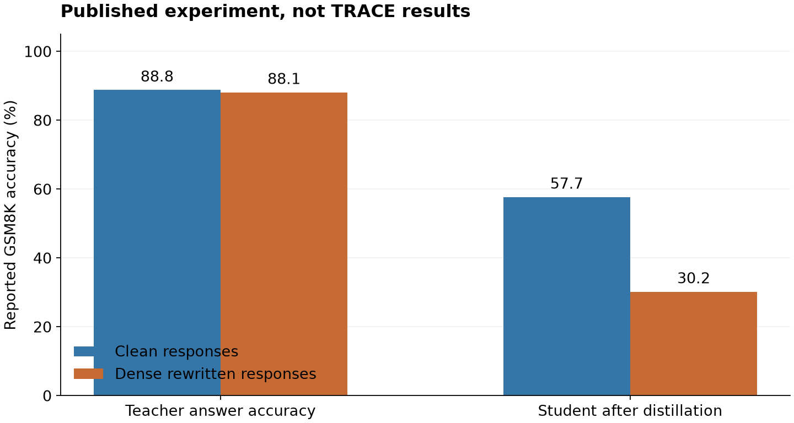

# Detect harvesting and reduce transferable reasoning

**The best implementable route for TRACE is a calibrated behavioral stop combined with a separately tested response defense.** Extend the sequence features and source-disjoint classifier already in the repository, calibrate the probability of any false stop over complete campaigns, and enforce before another answer reaches the client. In parallel, test whether answer-preserving, dense rewriting of reasoning traces reduces real student learning at acceptable user cost. This is a concrete research hypothesis, not a discovered universal solution. A client that makes exactly the same observable requests as a legitimate customer and trains on the answers afterward cannot be distinguished by an API detector. For that client, protection must change what the service releases, or accept that useful answers remain learnable. The first decisive experiment is therefore a small clean-distillation baseline followed by protected-output and adaptive-attacker comparisons, rather than another detector threshold sweep.

Research conducted **2026-11-02 to 2026-11-03**. Eighteen relevant primary papers are saved in [`papers/`](./papers), with revision details, inspection scope and caveats in [PAPER_INDEX.md](./PAPER_INDEX.md) and verified file metadata in [PAPER_MANIFEST.json](./PAPER_MANIFEST.json). The review includes October 2026 work. Published findings, repository observations, mathematical deductions and proposed experiments are distinguished below. Nothing here constitutes a new TRACE effectiveness result. No teacher queries, GPU training or product-code changes were performed for this research.

## Useful answers impose a real detection limit

### Hidden training intent is not an observable feature

Consider the complete information available to the defender through a declared observation horizon: prompts, timing, authenticated account information, previous answers, and outcomes of any interactions. Call this transcript \(O\). Let \(P_A\) and \(P_B\) describe its distribution under extraction and legitimate use. For any randomized detector \(\delta(O)\in[0,1]\), the variational definition of total variation gives

\[
\operatorname{TPR}-\operatorname{FPR}
=\mathbb E_{P_A}[\delta]-\mathbb E_{P_B}[\delta]
\leq\operatorname{TV}(P_A,P_B).
\]

Thus a detector constrained to false-positive probability \(\alpha\) satisfies \(\operatorname{TPR}\leq\alpha+\operatorname{TV}(P_A,P_B)\). If a legitimate batch customer and an extractor generate identical observable traffic, \(P_A=P_B\), and **the detector's true-positive rate cannot exceed its false-positive rate**. This is our direct mathematical deduction, not a theorem claimed to have been proved for TRACE by a particular paper. Better embeddings cannot recover the unobserved fact that someone later used an answer for training. Interactive challenges help only when they produce an observable difference; an attacker capable of imitating legitimate behavior can pass them too.

This does not make detection useless. Many harvesting processes do differ from ordinary usage. It changes what success means: recognize a declared, distinguishable collection process, interrupt acquisition before it teaches a useful student, and measure the legitimate work lost. A proof-of-work puzzle adds cost, but does not remove a released label. A delay that outlasts an experiment's deadline can reduce deadline-specific acquisition without reducing eventual learning. Neither should be called prevention without the relevant downstream measurement.

Published evidence supports this distinction. The recent LLM MMD detector reports 100% pure-attacker TPR and 0.3% benign FPR in its offline aggregate evaluation, with default 1,500-query windows. Its limitations include diluted traffic, semantic matching, drift and incomplete adaptive testing. These are window results, not demonstrated interruption before useful learning. A newer lifecycle benchmark reports MMD TPR/FPR of 0/0 for SeqKD and 100/0 for QEDKS in its specific experiment, using 20 attack batches per method. The detector recognized one collection pattern while missing another. ([LLM MMD, EMNLP 2026](https://aclanthology.org/2026.emnlp-main.748/); [Lifecycle benchmark, v2, Appendix E.4](https://arxiv.org/abs/2610.00839v2))

Dilution has a simple population-level explanation. For a mixture \(P_\rho=(1-\rho)P_B+\rho P_A\), linearity of kernel mean embeddings implies

\[
\operatorname{MMD}(P_\rho,P_B)=\rho\operatorname{MMD}(P_A,P_B),\qquad
\operatorname{MMD}^2(P_\rho,P_B)=\rho^2\operatorname{MMD}^2(P_A,P_B).
\]

At 5% attack mixture, squared population MMD is 0.0025 times its pure-attack value for the same distributions and kernel. This calculation does not determine finite-sample power, but shows why adding benign padding can suppress a distributional signal. PRADA and VarDetect established stateful extraction detection in classifier settings; VarDetect also reports a particular 5% dilution miss. Neither establishes general LLM protection. ([PRADA](https://arxiv.org/abs/1805.02628v5); [VarDetect, Section 7.3.1](https://arxiv.org/abs/2107.05166v1))

### TRACE already contains more than a query cap

The inspected checkout has a pinned BGE encoder, 100-query default windows, a multiscale RBF MMD statistic and upper-tail null ranks. Its default accumulator is \(r_t=\max(0,0.9r_{t-1}-\log p_t-1)\). At zero state, a rank \(p_t\geq e^{-1}\) adds no evidence. Independent attempt limits, quotas and rate restrictions coexist with detector-triggered actions. This means it is essential to separate their outcomes rather than call every refused request a successful detector intervention. See [encoder.py](/home/rajveer/Projects/TRACE/packages/harness/src/harness/encoder.py:10), [calibration.py](/home/rajveer/Projects/TRACE/packages/harness/src/harness/calibration.py:34), [accumulators.py](/home/rajveer/Projects/TRACE/packages/harness/src/harness/accumulators.py:13) and [policy.py](/home/rajveer/Projects/TRACE/packages/harness/src/harness/policy.py:414).

A saved development audit exposes the actual failure mode. A1's 60 window scores have median 0.0043 against benign-null median 0.0484. Upper-tail p-values have minimum 0.947 and median 0.995, so none crosses 0.05. The attack looks less unusual than the specialist-heavy null in the tested direction. This is an inspected stored result, not a rerun, and it does not demonstrate a defective MMD implementation. Flipping to the lower tail would simply risk labeling legitimate broad batches as attackers. See [diagnose-detector.json](../readings/v4/results/diagnose-detector.json) and [reproduce.json](../readings/v4/results/reproduce.json).

TRACE already has follow-up, template, timing, topic-transition and novelty features, conditional MMD, fixed-weight fusion, and source-disjoint ridge-logistic separation. A generic classifier is therefore not a new solution. The meaningful work is to test whether these features survive realistic matched benign traffic, then calibrate the complete stopping policy. Existing documentation reports sparse coding/math nulls, 13 relevant multi-domain horizons, specialist false alarms and unstable source-split separation. The TODO also records that the measured AG News transfer covers under 1% of A1's released tokens while the dominant math/coding portions lack student evaluation. These limitations explain why a sophisticated gateway can still lack evidence that it prevents distillation. See [signals.py](/home/rajveer/Projects/TRACE/packages/harness/src/harness/signals.py:43), [separation.py](/home/rajveer/Projects/TRACE/packages/harness/src/harness/separation.py:349), [docs/harness.md](/home/rajveer/Projects/TRACE/docs/harness.md:28) and [TODO.md](../TODO.md).

## Calibrate behavioral evidence over whole campaigns

### Test collection structure against legitimate lookalikes

The proposed score should describe how information is collected, not how many requests have been made. Freeze the encoder and task taxonomy, then extend the existing separation study using a small regularized model. Candidate inputs include domain-conditioned semantic coverage, systematic variation within prompt templates, repeated sampling of the same problem, relation of a follow-up to the previous answer, and sustained requests for detailed supervision. These are hypotheses. Educators, CI agents, translation services and evaluation customers can exhibit the same behaviors, so their matched workloads belong in the benign population.

A compact geometric feature can quantify novelty without another language model. Project normalized embeddings into a fixed 64-dimensional space, with \(\|v_t\|\leq1\), and maintain

\[
A_t=\lambda I+\sum_{i<t}v_iv_i^\top,\qquad
g_t=\log(1+v_t^\top A_t^{-1}v_t).
\]

The determinant lemma makes \(g_t\) the increment in log determinant after adding this request. A Sherman–Morrison update costs \(O(64^2)\) per request, excluding encoding. This is a coverage proxy, **not mutual information about teacher weights or a predicted amount of learning**. Compare its distribution at matched domain and prefix length; cumulative coverage alone would recreate a volume threshold. Existing nearest-neighbor features remain a baseline, and the new feature earns its place only through held-out improvement.

For a pilot, predetermined windows of 32, 64 and 128 requests are reasonable engineering choices, not established optima. Include every planned look and scale in policy calibration. Fit and select models on disjoint source families, accounts and time blocks; keep related templates together. Hold out an entire attacker family. Repeat the decisive comparison after excluding count, request rate, corpus identity and source-membership flags. A classifier that succeeds only with those variables has not answered the user's question.

Cross-account overlap is optional evidence, not reliable identity proof. Unusual shared sequences can justify scrutiny when authenticated organization linkage exists. A shared IP or common public prompt does not justify merging unrelated people. Freeze and calibrate the grouping algorithm itself, including switching and missing metadata. Encoding truncation also matters: the current 512-token limit can hide late content, so the study must specify handling of long prompts rather than quietly score their prefixes as complete requests.

### A complete-path rank gives an honest finite-horizon guarantee

The practical first method is **whole-campaign maximum calibration**, using the existing scorer rather than inventing an unjustified anytime statistic. Declare the unit before looking at test scores, such as an authenticated organization-day or a finite session horizon \(H\). This defines the error claim; it does not require denying service when a request count is reached. Freeze fitting, model selection, grouping, supported contexts, missing-data behavior and the look schedule before policy calibration.

For each untouched benign calibration campaign \(i\), compute the maximum of the score over its entire permitted path:

\[
M_i=\max_{t\in\mathcal T_i,\ t\leq H}f_\theta(H_{i,t},c_i).
\]

If several detectors or scales can trigger a stop, include them in this predeclared path maximum, after fixed score transformations. At runtime maintain \(m_t=\max_{s\leq t}f_\theta(H_s,c)\) and calculate

\[
p_t^*=\frac{1+\sum_{i=1}^{n}\mathbf1\{M_i\geq m_t\}}{n+1}.
\]

Stop at the first \(p_t^*\leq\alpha\). Under exchangeability of calibration and new benign campaigns, conditional on the separately frozen training/selection procedure, the final maximum has a conservative super-uniform rank. Each prefix maximum is no larger than that final maximum, so its rank is no smaller. Therefore

\[
\Pr_B\{\exists t\leq H:p_t^*\leq\alpha\}\leq\alpha.
\]

This is our finite-sample rank argument. It permits dependent turns and overlapping windows inside a campaign because calibration includes the same entire path. It does not guarantee behavior under arbitrary drift, reference contamination, a changed scoring schedule or a changed population. The guarantee is marginal over calibration and the new campaign, not conditional on every realized calibration set. Conservative handling of ties uses the displayed greater-than-or-equal comparison. The rank is not a posterior probability of malicious intent.

The minimum attainable rank is \(1/(n+1)\). Even attaining a 1% threshold requires 99 calibration campaigns; 0.1% requires 999. Those counts alone do not establish useful power or certify a fixed deployed threshold. Sparse supported strata should abstain from statistical refusal. Any separately claimed conditional guarantee needs enough data within that predeclared stratum; a pooled result cannot silently become a guarantee for every specialist.

The following pseudocode expresses the required ordering. It is a design sketch, not code implemented in this research. Features are computed outside a database write lock. A per-campaign ordered executor supplies the actual prefix; only cheap evidence/state changes and reservations occur atomically. A stopped actor cannot erase the decision by changing context or reaching a new horizon.

```python
features = encode_immutable_request_fields(request)  # outside write transaction
with ordered_campaign_admission(campaign_id):
	with admission_transaction(campaign_id) as state:
		if state.durable_stop:
			return refuse("prior_behavioral_stop")
		period = resolve_predeclared_period_without_erasing_stop(state)
		append_observed_request(state, request, features)
		if supported_complete_policy_path(state, period):
			if scheduled_look(state):
				score = frozen_scorer(state.observed_prefix)
				state.maximum = max(state.maximum, score)
				p = conservative_rank(state.maximum, period.null_maxima)
				if p <= period.alpha and policy_is_qualified:
					state.durable_stop = True
					return refuse("calibrated_behavioral_evidence")
		else:
			record_statistical_abstention(state)
		return reserve_teacher_admission_with_policy(state, request)
# Teacher generation occurs after the transaction commits.
# A separate release guard checks policy before any response bytes leave.
```

An incoming-prompt decision can withhold that request before inference. A decision using the new answer must buffer it before release, or affect later requests. Persist state across restarts, deduplicate retries and measure in-flight overshoot. The release guard must settle existing reservations correctly when policy changes during generation; a claim of zero leakage requires actual concurrency evidence. Do not hold SQLite write locks during encoding, teacher generation or rewriting.

Begin with shadow scoring and one terminal intervention. A warning, proof-of-work challenge or response alteration changes what a benign client does next. Calibration must represent that same interactive policy; shadow traces do not automatically qualify an adaptive ladder of interventions. Freeze stratum switching as part of the whole path. Unsupported traffic can trigger an abstention, but cannot reset accumulated evidence or a durable stop.

Across repeated periods or separately tested accounts, state which error budget is controlled. A fixed organization-day rate is often the honest claim. For a lifetime bound, one option is \(\alpha_j=\alpha_{\mathrm{total}}6/(\pi^2j^2)\), using a union bound when each period's marginal bound holds. This rapidly worsens calibration resolution and power. Starting fresh full-α tests after resets does not preserve a lifetime guarantee. Sybil splitting additionally defeats behavioral accumulation unless linkage is justified; significance alone cannot establish identity.

### Betting is valid only when the conditional null is valid

A genuine e-process needs nonnegative factors satisfying \(\mathbb E_0[e_t\mid\mathcal F_{t-1}]\leq1\). Their product is then a nonnegative supermartingale, and Ville's inequality bounds the chance of ever reaching \(1/\alpha\). As an example, a predictable bounded score \(h_t\in[-1,1]\) applied to a pair with equal conditional marginals gives \(d_t=[h_t(X_t)-h_t(Y_t)]/2\) and \(e_t=1+\eta_t d_t\), with predictable \(\eta_t\in[0,1]\). The crucial condition is equality given the past. Drawing a historical query from the same topic does not establish it for a live conversational turn. ([Nonparametric two-sample testing by betting](https://arxiv.org/abs/2112.09162); [Conformal test martingales](https://proceedings.mlr.press/v152/vovk21b.html))

Do not multiply transformed marginal window ranks and call the result anytime-valid. Dependence, reused reference data and score adaptation matter. Conformal martingale constructions require their stated exchangeability and randomization conditions. The existing accumulator names do not themselves establish those assumptions. Use complete-campaign calibration first; reserve betting for independent session units or a validated conditional model.

After freezing the operational threshold, perform an independent benign audit. For zero false stops in \(n\) IID campaign-level Bernoulli trials, the exact one-sided 95% upper bound is

\[
p_{\mathrm{FP}}^{\mathrm{upper}}=1-0.05^{1/n}.
\]

Thus **299 zero-failure audit campaigns** place that bound below 1%, and **2,995** place it below 0.1%. These are audit counts, separate from rank-calibration counts. Overlapping windows from a few customers do not meet this IID model, and exchangeability alone is insufficient for it. Retuning after audit failures requires a fresh audit. Production drift still needs monitoring and explicit loss of qualification when assumptions fail.

## Change learnability where detection cannot help

### Dense rewriting is the first output experiment worth running

A useful output defense changes how much a student learns while preserving the service's intended value. The most practical reviewed candidate is the published dense-formal reasoning rewrite instruction. Appendix E.3 of *Protecting Language Models Against Unauthorized Distillation through Trace Rewriting* uses DeepSeek-R1-Distill-Qwen-7B as both teacher and rewriter, with a Llama-3.2-3B student on GSM8K. Teacher accuracy changes from **88.8% to 88.1%**, while student accuracy changes from **57.7% to 30.2%**. The student difference is 27.5 percentage points. This small self-rewriter condition is especially relevant; the main setup uses a 120B rewriter. Reported hardware is A100/H100. The instruction promotes formal, dense deductions, not ordinary paraphrasing. Its quality study uses an LLM judge rather than human users, and tested adaptive defenses do not cover every learner. ([Trace rewriting, Appendix A.2 and E.3/Table 5](https://arxiv.org/abs/2602.15143v2))



*Published experiment only; uncertainty intervals were not supplied for this table. The comparison motivates a local falsification attempt, not a prediction for this GPU or TRACE's model pair.*

Our proposed implementation reuses one loaded teacher checkpoint sequentially: generate and privately cache a clean answer, ask the same model to rewrite its reasoning using the published instruction, then unload it before student training. Avoid reproducing expensive prompt optimization first. For a stricter application variant, extract the final answer into an immutable field and rewrite only the explanation. Validate the task answer and explanation consistency before release. That stricter variant differs from the paper and must be reported as such; pilot a paper-style condition as well so failure can be interpreted.

The proposed mechanism is conditional. A small student trained with ordinary completion loss might find an unusually dense explanation harder to learn from, while the teacher's final answer remains correct. This is a hypothesis about a particular learner and supervision format, not cryptographic information destruction. A stronger student, simplifier, selective loss or reconstruction process can recover the teaching signal. Correct answers remain labels. Correct code remains executable supervision. Nothing in the mathematical argument makes them non-distillable.

Compare the rewrite with a compact verified solution, final-answer-only output and ordinary paraphrasing. Measure released tokens and training exposure because rewriting can lengthen responses. Equal-query and equal-token comparisons answer different questions; neither substitutes for the other. Also test whether users can still understand and use the explanation. If an education service becomes incomprehensible, unchanged final-answer accuracy does not preserve its utility.

A policy applied only after detection leaves exactly matched attackers untouched. An always-on response policy reaches those attackers but changes the product for everyone. Treat these as separate arms and price their legitimate cost separately. Do not allow clean internal drafts to escape through streaming chunks, debug responses, logs available to tenants, tool outputs, alternative endpoints or fallback paths. If rewriting fails, a documented fallback must be included in both learning and utility measurements; silently releasing the clean draft defeats the defense precisely when the transformation fails.

### Recent adaptive work argues against declaring victory early

DistillGuard finds that ordinary paraphrasing barely impairs its naive attacker. Removing chain-of-thought reduces math performance in its evaluated model pair, but has much less effect on code. This reinforces task-specific testing. The October 2026 *Learnability* paper shows that learners can reweight useful reasoning despite disruptive tokens. Its BLADE Unicode intervention drops GSM8K accuracy to 7.50% in one setting, but OCR reconstruction raises it to 55.31%, against 72.48% clean distillation. A visually readable string can still be recoverable training data, while being inconvenient for legitimate parsers and accessibility tools. ([DistillGuard](https://arxiv.org/abs/2603.07835v1); [Learnability of antidistillation reasoning traces, Appendix Table 6](https://aclanthology.org/2026.findings-emnlp.867/))

ADS modifies sampling using a proxy student's loss response, requiring local logits and additional proxy forward passes. Its stated cost estimate is about twice generation computation when the proxy has half the teacher's size. DOGe instead trains the teacher's final head using a task-preserving loss and proxy divergence. Both merit later comparison, but introduce additional modeling and runtime requirements before this repository has a qualified clean-transfer baseline. Their defenses also face attackers that ignore harmful tokens while learning useful content. ([Antidistillation Sampling](https://arxiv.org/abs/2504.13146v5); [DOGe](https://arxiv.org/abs/2505.19504v2))

Lossless Anti-Distillation Sampling is a cheap optional arm for redundant multi-account collection. It keys sampling randomness to a semantic bucket and per-account bucket counter; accounts couple when both align. It preserves an individual account's sampling law under its assumptions, so it is not a single-account solution. Different prompts sharing a seed need not produce identical text. Its theorem provides a uniform-convergence upper bound under regularity and concentrated querying, not a lower bound proving every student learns less. Broad unique queries, greedy decoding and deliberately offset counters are mandatory attacks. The paper's table and nearby prose also disagree on one reported improvement, so this report does not use that inconsistent headline. ([LADS, Algorithm 2 and Theorem 2](https://arxiv.org/abs/2605.18829v2))

Watermarks answer an attribution question after training. The October 27 Watermark Basins preprint requires suspect-model outputs and estimates about 450 GPU-hours for its full reference bank, with a smaller subsequent audit cost. Earlier removal work shows useful transfer can survive suppressed watermark evidence. Neither should be the first preventive intervention on one inference GPU. Knowledge Honeypot is a more active alternative for response-guided entity expansion, but a fixed external query corpus need not follow the injected suggestions. Its suspicion features also include session progression, so it should not be mistaken for an independent hidden-intent test. ([Watermark Basins](https://arxiv.org/abs/2610.37266v1); [Watermark removal](https://arxiv.org/abs/2502.11598v2); [Knowledge Honeypot](https://arxiv.org/abs/2606.15810v1))

## Train real attackers before claiming protection

### First establish that the chosen student can learn

The first experiment should be **clean transfer on one objective task**, using a pinned roughly 2B student and a fresh math source family. Measure base and teacher on 300–500 held-out problems for development, reserving a separate confirmatory set. A proposed initial gate is at least a ten-point teacher advantage with uncertainty excluding zero; this is a study choice, not a universal threshold. If there is no headroom, choose another domain or base. Then train from that same base on 300 and 1,000 clean examples, measuring whether gain is reproducible. If clean transfer fails, fix the learning experiment before comparing defenses. An incapable attacker makes every intervention look effective.

The literature explains why both gates matter. *The False Promise of Imitating Proprietary LLMs* found substantial differences between copied style and capability in its older model/data setting. Conversely, s1 demonstrates the value of a small curated reasoning dataset with a strong pretrained model; its 32B and multi-H100 recipe is not a hardware plan for this machine. These results motivate testing actual transfer rather than assuming either that every response is equally valuable or that small collections are harmless. ([False Promise](https://arxiv.org/abs/2305.15717v1); [s1](https://arxiv.org/abs/2501.19393v3))

Let \(A_T,A_B,A_C,A_D\) be objective held-out task accuracy for teacher, untrained base, clean-distilled student and protected-output student. Report these raw values first. When teacher-base headroom is positive and statistically stable, define

\[
R_C=\frac{A_C-A_B}{A_T-A_B},\qquad
R_D=\frac{A_D-A_B}{A_T-A_B}.
\]

When clean learning gain is convincingly positive, define transfer suppression

\[
S=1-\frac{A_D-A_B}{A_C-A_B}.
\]

Otherwise mark the corresponding ratio undefined. Do not clip values into \([0,1]\); negative suppression and students exceeding teachers are possible outcomes. Use paired task-family resampling to propagate denominator uncertainty, and report variability across training seeds separately. A single seed is development evidence, not a stable capability claim.

### Use controls that can disprove the proposed mechanism

The evaluation needs an untrained base, a clean-output student and a protected-output student from the same pinned initial checkpoint. Add clean students matched on query count and on released supervision tokens, plus clean truncated/subsampled controls. A short-output defense must face an equal-token attacker allowed more distinct examples, with those extra queries, cost and time recorded. Equal optimizer steps do not equalize information. Include a quota baseline chosen at the same legitimate task-success loss, rather than comparing an aggressive content gate to a harmless quota or vice versa.

Train adaptive students on final-answer extraction, cleaned or simplified explanations, and protected outputs with high-loss-token filtering. An additional arm should ask the teacher directly for a concise correct solution. If budget permits, let the attacker reconstruct explanations using its own pretrained model, and test a stronger student in the second stage. Fix attacker compute for the main comparison and declare any expanded-compute attack separately. A gold-answer or trusted-data run is a diagnostic for whether the training recipe can learn the task at all.

For the detector, use matched-source benign educators, evaluators, coding CI and bulk customers with the same domains, lengths, volume and rates as attackers. Include benign specialists, topic-sorted extraction, conversational wrappers, paraphrasing, low-and-slow collection, benign padding and Sybil splitting. Most importantly, run an **exact matched-observable negative control**: duplicate the same prompts, timestamps, metadata and history, then assign one copy legitimate downstream use and the other later training. The scores must match. Apparent discrimination is experimental leakage.

Evaluate capability using outputs actually acquired before the first restriction and all subsequently released in-flight outputs. Train prefix students when possible to locate the earliest point at which useful transfer occurs. Eventual detection is insufficient if that point precedes enforcement. Separate first alert, first challenged admission, first withheld response and durable refusal. Separate detector causes from quotas, attempt caps, upstream failure and rate limits. Delayed answers must reappear in eventual-acquisition metrics if the client ultimately receives them.

For legitimate users, report probability of any unjustified intervention within a complete horizon, restricted responses, task completion, explanation adequacy, delivered-token cost, challenge burden and p50/p95 latency. Break out role, domain, language and workload strata where evidence supports doing so. A low per-window false-positive rate can accumulate into an unacceptable account-level rate. Independent human explanation judgments are needed when explanation quality is part of the product; objective math correctness alone cannot certify it.

The study objective is

\[
\min_\pi\max_{a\in\mathcal A_{\mathrm{tested}}}
\bigl[U(S_{a,\pi})-U(S_{\mathrm{base}})\bigr]
\quad\text{subject to}\quad
U_B(\pi)\geq U_B(\mathrm{clean})-\epsilon.
\]

Here the policy includes admission and output transformations, while an attack includes collection, preprocessing and learning. This is an optimization target over tested attacks, not a guarantee against every possible learner. Predeclare a useful minimum effect, for example a five-point accuracy reduction or 25% of clean transfer gain, alongside a proposed two-point overall legitimate task-success loss budget and explicit specialist limits. These are starting choices to negotiate against service requirements; do not select them after seeing results.

## A single-GPU pilot can reach a defensible verdict

### Serialize model work and measure the actual machine

The exact GPU identity and VRAM remain unverified. The attempted inventory command exited 139 without output; the user's wording must not be silently interpreted as a particular RTX 4000 Ada or RTX PRO model. First confirm the machine, software stack, free VRAM and a short throughput benchmark. Do not promise training time from a marketing name or from repository planning metadata.

Use sequential stages: cache clean teacher responses, generate protected variants, unload the teacher, train the student, then evaluate. For the self-rewrite experiment, one loaded checkpoint can generate and rewrite in separate batches. This avoids requiring simultaneous teacher, rewriter and student residency, but adds generation work and latency that must be measured. Start with a short context and a tiny throughput/peak-memory pilot before committing to 1,000 full examples.

The existing learning-curve runner supplies useful infrastructure: a pinned Qwen3.5-2B-Base, rank-16 LoRA, BF16, completion-only loss and gradient checkpointing. It is explicitly AG News-only, assumes a model class, uses a 16-token evaluation generation limit and rejects overlength examples. Math/coding need a versioned recipe with appropriate parsing, evaluation and generation lengths. Four-bit loading is a separate implementation, not an existing flag. If BF16 fits, start there; otherwise add and qualify QLoRA against a clean-transfer baseline. QLoRA's frozen 4-bit weights reduce memory, but do not guarantee a particular model/context fits or runs quickly. See [learning_curve.py](/home/rajveer/Projects/TRACE/packages/distillation/src/distillation/learning_curve.py:15), [learning_curve_runner.py](/home/rajveer/Projects/TRACE/packages/distillation/src/distillation/learning_curve_runner.py:14) and [QLoRA](https://arxiv.org/abs/2305.14314v1).

A three-to-seven-day pilot is plausible only after throughput measurement. Day one establishes hardware feasibility and teacher-base headroom. Days one to three cache the first responses and demonstrate clean learning. Days three to five screen rewriting, compact solutions and final-answer controls, initially with one seed. Days five to seven repeat only the surviving comparisons with three seeds and the strongest affordable adaptive preprocessing. Do not spend the entire budget training several nearly identical baselines before establishing a positive clean gain.

A conditional second week adds a fresh confirmatory source partition, a second task family, more seeds if affordable, and real gateway replay with concurrency and restart tests. Five training seeds are preferable to three when variability is material, but a slower GPU should reduce scope rather than quietly weaken claims. Long reasoning traces and coding evaluations can dominate runtime. The schedule is a proposed workload, not a benchmark.

### Integrate only the parts that pass their evidence gates

The implementation sequence is short. First version the math transfer recipe and artifact manifests so every acquired example has provenance, prompt identity, response policy, delivered-token count and model revision. Next extend [signals.py](/home/rajveer/Projects/TRACE/packages/harness/src/harness/signals.py:43) only where matched-source separation warrants it, and use [separation.py](/home/rajveer/Projects/TRACE/packages/harness/src/harness/separation.py:349) as the feasibility gate. Then add complete-path calibration and immutable policy metadata; retain [fusion.py](/home/rajveer/Projects/TRACE/packages/harness/src/harness/fusion.py:1) as unqualified shadow evidence unless its actual full decision path passes calibration. Only afterward connect the qualified stop through [Policy.admit_in_transaction](/home/rajveer/Projects/TRACE/packages/harness/src/harness/policy.py:142).

For output protection, use the already buffered generation boundary before response release and settlement in [app.py](/home/rajveer/Projects/TRACE/apps/harness-api/src/harness_api/app.py:735). Keep clean internal drafts inaccessible to clients, record the exact released representation, and reconcile durable admission/reservation/release events. The gateway already has durable accounting; `off_path` scoring rejects that durable mode because queued evidence is process-local. Preserve the distinction instead of bypassing it for a fast prototype. The campaign report also acknowledges incomplete admission coverage, so primary release metrics should come from the authoritative ledger. See [app.py](/home/rajveer/Projects/TRACE/apps/harness-api/src/harness_api/app.py:880) and [evaluation_protocol.py](/home/rajveer/Projects/TRACE/packages/distillation/src/distillation/evaluation_protocol.py:19).

A credible success statement would name the task, teacher/student revisions, attack family, acquired-token budget, legitimate utility loss and confidence interval. It would show that interruption occurred before useful transfer, or that always-on protected responses suppressed measured learning despite adaptive use. It would not say that TRACE can infer all training intent. Rewriting and detection should first be evaluated separately so a combined result does not hide which mechanism works.

Abandon the proposed detector if source/count matching removes its advantage, benign bulk work is restricted at comparable rates, or a useful student emerges before the first stop. Abandon the output defense if equal-token acquisition, final-answer learning, simplification or robust losses recover the clean gain at comparable cost. If preserving explanations is incompatible with suppression, describe the actual product tradeoff. If no behavioral separation exists and no acceptable output transformation suppresses learning, **the desired prevention promise is unattainable for that threat model**. The correct research outcome is a measured boundary, not a renamed quota.

The strongest useful claim this project can earn soon is narrower and more valuable than a universal detector: a specific service policy makes a realistic learner measurably weaker, early enough to matter, while preserving declared legitimate work. The first clean-transfer experiment determines whether TRACE can test that claim at all. Everything that follows should be allowed to fail against the strongest affordable attacker.
